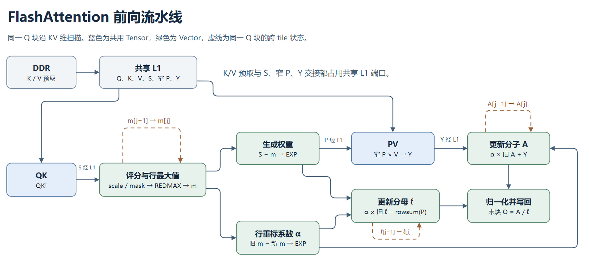

# FlashAttention 前向稳态流水线与资源配比

**当前配置更新。** 按 00.param.txt，Vector 每类执行单元各一套，不同类型独立并发。同类型工作累加到同一资源。Vector 访存采用第 7 节的流式重叠规则，带宽充足时在计算边界表现为首拍输入与末拍输出延迟。第 5 节保留其明示的整块交付算例。

**每个 KV tile 的启动间隔 $II$ 决定稳态吞吐，单位是 cycle/tile。** 若 QK、Softmax、PV 各有独立硬件，且反馈、带宽与缓冲都允许每隔 $II$ 启动一个 tile，$II=\max(II_{\rm QK},II_{\rm Softmax},II_{\rm PV})$。如果 QK 和 PV 共用一套 Tensor，同一个 tile 要在这套阵列上占用两次，稳态 Tensor 下界是 $t^{\rm occ}_{\rm QK}+t^{\rm occ}_{\rm PV}$。Vector 中不同子链竞争同一物理单元时采用同一规则。单 tile 的端到端延迟由依赖和排队共同决定。

本文以固定 $M$ 行 Q 连续扫描宽度为 $N$ 的 KV tile 为主。所有服务率都用每周期的有效量，容量用 KiB，矩阵 FMA 计 1 MAC 或 2 FLOP。既有文档给出了 [逐节点时序](flashattention-forward-pipeline.zh.md) 和 [整段算力带宽账本](README.md)。这里补充共享资源的稳态下界、容量约束，以及一组达到下界的排程。

## 1. 从依赖图划分流水

对同一 Q 块的第 $j$ 个 KV tile，令 $Q\in\mathbb{R}^{M\times d_k}$、$K_j\in\mathbb{R}^{N\times d_k}$、$V_j\in\mathbb{R}^{N\times d_v}$。所有行量沿列广播，$A$ 是未归一化输出分子。

$$
\begin{aligned}
S_j &= QK_j^\top/\sqrt{d_k}+\mathrm{mask}_j, \\
r_j &= \operatorname{rowmax}(S_j), \qquad m_j=\max(m_{j-1},r_j), \\
\alpha_j &= \exp(m_{j-1}-m_j),\qquad P_j=\exp(S_j-m_j),\\
z_j &= \operatorname{rowsum}(P_j),\qquad Y_j=P_jV_j,\\
\ell_j &= \alpha_j\ell_{j-1}+z_j,\qquad A_j=\alpha_j A_{j-1}+Y_j.
\end{aligned}
$$

首个有效块直接初始化 $m,\ell,A$。最后一块的 $\ell,A$ 都就绪后，按行生成 $O=A/\ell$，需要 LSE 时另算 $m+\log\ell$。跨块保留的是 $m,\ell,A$；全 mask 块和全空行按所选实现的有效性规则处理。图中的 $P$ 转换可放在 PV 支路，行求和仍可用转换前的 $P$。数值比较需固定 mask、累加与转换精度。[FlashAttention-2，算法 1](https://arxiv.org/html/2307.08691)

| 逻辑段 | 推荐的发射或交付边界 | 主要并行机会 |
|---|---|---|
| DDR 预取 → QK | 分开跟踪 K/V 就绪与槽位释放，QK 只等 Q/K | V 与 QK、Softmax 可并发，QK 可前瞻后续 tile |
| Vector 评分与最大值 | scale/mask → REDMAX → 行 MAX 合并 | $r_{j+1}$ 可在 $m_j$ 就绪前先算，合并才需要上一块 $m$ |
| Vector 生成权重 | $S_j-m_j$ → EXP，另发 $\alpha_j$ | 两支可独立就绪。共用 SUB 或 EXP 时，发射由同一个仲裁器分配 |
| Vector 分母与 PV | $P_j$ 分流至 REDSUM 和 CVT；PV 等 $P_j$ 与 $V_j$ | PV 可与 REDSUM、分母更新重叠。若 PV 直接累加已缩放的旧分子，还要等 $\alpha_j A_{j-1}$ |
| Vector 分子更新与收尾 | 独立 PV 交付 $Y_j$，再用 FMA 更新 $A_j$ | $A$ 反馈可与后续块 QK 和生成 $P$ 重叠。归一化每个 Q 块做一次 |

硬件只有一个串行 Vector 指令发射口时，即使 EXP、归约、FMA 都有独立单元，仍需核算发射口、寄存器文件端口、广播和 shuffle。逻辑拆分优先放在**生产者可独立交付、消费者可独立发射**的位置。Tensor/Vector 矩阵与向量交接适合独立队列，Vector 内部的逐元素算子优先通过寄存器或直连融合。在整行最大值未知时，仍需保留或重读该行的 score。做 row group 或微块流式交付时，按实际的整行归约边界建依赖。FlashAttention-3 的跨迭代 GEMM/softmax 重叠也依赖额外中间值槽位。[FlashAttention-3，第 3.2 节与附录 B.3](https://arxiv.org/html/2407.08608#S3.SS2)

## 2. 用资源占用和跨 tile 反馈推导启动间隔

为每个操作 $i$ 记录两个量：**结果可见延迟** $L_i$，以及在物理资源 $u$ 上的**占用量** $a_{i,u}$。例如完全流水化的 12-cycle EXP 可每 cycle 接收一组输入。持续处理 $n$ 组时，入口占用为 $n$ cycle，整块结果在最后一组发射后再等流水尾部。独占至结果就绪的接口则按整段占用。

### Tensor 与 Vector

若两种 GEMM 都用同一不可重叠阵列，持续速率分别为 $\rho_{\rm QK},\rho_{\rm PV}$ MAC/cycle，忽略额外独占开销时，

$$
II_{\rm T}=
\left\lceil\frac{MNd_k}{\rho_{\rm QK}}\right\rceil+
\left\lceil\frac{MNd_v}{\rho_{\rm PV}}\right\rceil.
$$

有独立阵列时取两个服务时间的最大值。$\rho$ 应随 tile 形状、精度、数据布局和阵列利用率变化。小 tile 可按硬件微块的 M/N/K 取整后计发射次数，再加真正占住阵列的复位或换型开销。阵列具备独立装载、计算、排空等端口时，分别记录占用，并为每个端口求下界。

在图中对应的显式 $Y=PV$、独立 $A$ 更新路径上，一个完整非首块的 Vector 基准账本如下。实际映射可替换融合后的操作，或增加谓词、打包和布局重排。

| 操作 | 每 tile 的工作量 |
|---|---:|
| score 缩放、score 减最大值 | 各 $MN$ 次，对应 MUL 与 SUB |
| REDMAX、REDSUM、与历史 max 合并 | 两种块内归约各 $M(N-1)$ 个二元操作，另有 $M$ 次行 MAX |
| $\alpha$ 的差分；权重与 $\alpha$ 的指数 | $M$ 次 SUB；$MN+M$ 次 EXP |
| $P$ 转换、分母更新 | $MN$ 次 CVT；$M$ 次 MUL 加 $M$ 次 ADD，或 $M$ 次 FMA |
| 分子更新 | $Md_v$ 次 FMA，或各 $Md_v$ 次 MUL 和 ADD；累加型 PV 只需先做 $Md_v$ 次 MUL |
| 收尾分摊到 $T$ 个 KV tile | $M/T$ 次 RCP、$Md_v/T$ 次 MUL，按需加输出转换和 LSE |

令某类等价单元 $u$ 有 $n_u$ 份，每份每 cycle 可接收 $p_{i,u}$ 个该操作。连续可均分负载时，其资源下界为

$$
II_{\rm V}=\max_u\frac{1}{n_u}\sum_{i\mapsto u}\frac{W_i}{p_{i,u}}.
$$

轮不到拆给不同单元的微块、整组发射与单元绑定要按实际 reservation table 取整。若一条指令同一周期占用多个资源，就在每个相关资源上各计一次。两个逻辑段各有 20 cycle 的独占 EXP 工作，只有一份 EXP 时，下界为 40 cycle/tile，即使两段之间没有数据依赖。两份 EXP 且有足够发射、数据供给和可均分工作时，这项平均下界降至 20。全局发射宽度 $w_{\rm issue}$ 再给出 $N_{\rm inst}/w_{\rm issue}$ 的下界。

### 反馈与汇合

对同一状态被相邻 tile 读写的路径，分别追踪 $m_j\to m_{j+1}$、$\ell_j\to\ell_{j+1}$、$A_j\to A_{j+1}$。例如行 REDMAX 有很长的延迟，但只要其结果可提前生成，$m$ 的反馈路径只经过历史 MAX 合并及状态可见延迟。独立的 PV 也可提前完成并等待 $A$ 的反馈。若实现让下一块先等待整个 Softmax 或 PV 完成再发射，就把这条额外边加回依赖图。

令操作 $i$ 在 tile $j$ 的发射时刻为 $j\,II+s_i$。边 $i\to k$ 的迭代距离为 $d_{ik}$，数据可见延迟为 $L_{ik}$，合法时序满足

$$
s_k-s_i+d_{ik}\,II\ge L_{ik},
\qquad II_{\rm rec}=\max_{\text{反馈环 }c}
\frac{\sum_{e\in c}L_e}{\sum_{e\in c}d_e}.
$$

例如同一状态回路占 160 cycle，单 context 每 tile 都依赖此前结果时 $II\ge160$。轮转 4 个独立 Q 块时，同一 context 每 4 个全局 tile 才重访，单条反馈约束降为 40 cycle/全局 tile。每个 context 自己的重访间隔仍是 $4II$，且各自占用 $Q,m,\ell,A$ 与在途槽位。可用 context 数、请求尾延迟和上下文切换成本共同决定这样做是否划算。[Rau，Iterative Modulo Scheduling，第 3 节](https://shiftleft.com/mirrors/www.hpl.hp.com/techreports/94/HPL-94-115.pdf)

## 3. DDR 与共享 L1 的读写账本

定义字节量 $q=Md_kb_Q,\ k=Nd_kb_K,\ v=Nd_vb_V,\ s=MNb_S,\ p=MNb_P,\ y=Md_vb_Y,\ a=Md_vb_A,\ o=Md_vb_O$。下表假设 Q 在 L1 驻留、Tensor 每个 tile 从 L1 取一次 Q，S/P 经 L1 交接，Vector 内部中间值驻留本地，K/V 每个 tile 从 DDR 读入一次。无外存 mask。每行的读写都按**穿过该物理接口**的次数计量。

| 对象 | DDR 读 / 写 | 共享 L1 读 / 写 | 发生频率 |
|---|---:|---:|---|
| Q | $q/0$ | $Tq/q$ | DDR 装一次，QK 读 $T$ 次 |
| K、V | $(k+v)/0$ | $(k+v)/(k+v)$ | 每 KV tile |
| S、窄 P | $0/0$ | $(s+p)/(s+p)$ | 每 KV tile；Tensor 写 S 读 P，Vector 读 S 写 P |
| $Y$（独立 PV 输出） | $0/0$ | $y/y$ | 经 L1 时每 KV tile；走专用直连时在直连上计费 |
| $m,\ell,A$ | $0/0$ | 依落点而定 | 本地驻留为零；若只把 $A$ 溢到 L1，单次读旧写新至少 $a/a$ |
| O | $0/o$ | $o/o$ | 每 Q 块完成后一次，假设经 L1 写回 DDR |

任意边界上的复用都用该边界的**实际传输次数**更新。例如 Tensor 局部 Q 驻留让 L1 的 $Tq$ 变成 $q$，跨 Q 块或 GQA 头复用 K/V 只减去确实共享的那一层流量。有显式 mask、压缩/量化 KV、分页地址、对齐、bank padding、重读和写分配时，把实际事务字节加到账本。

独立读写端口的外存及 L1 约束分别为

$$
II_{\rm DDR}=\max\!\left(\frac{D^r_{\rm DDR}}{B^r_{\rm DDR}},\frac{D^w_{\rm DDR}}{B^w_{\rm DDR}}\right),
\qquad
II_{\rm L1}=\max\!\left(\frac{D^r_{\rm L1}}{B^r_{\rm L1}},\frac{D^w_{\rm L1}}{B^w_{\rm L1}}\right).
$$

$D$ 按 tile 计，首尾开销可在长流中单独处理，或在连续 Q 块的预算中按 $T$ 摊销。DDR 共用双向数据通路时，计 $D^r/B^r+D^w/B^w$ 并加换向与事务开销。对同一组 L1 bank 共享读写的结构，按各 bank、端口和互斥规则分别约束。DMA 写入 L1 会与 Tensor 和 Vector 的 L1 写入竞争，即使 DMA 读取的是 DDR。还要检查 Tensor/Vector 各自端口的上限与仲裁保证。

这些式子给出**平均带宽下界**。在给定节拍 $I$ 下，每类资源至少需要 $D/I$，而合法时序还要求每个 cycle 的聚合需求符合对应端口上限。两条传输共用 512 B/c 的读口，同时各要 384 B/c 时，要改发射相位、限速或排队。对单次操作，若本地接口可流式读、算、写，可用 $L_0+\max(D^r/B^r,W/p,D^w/B^w)$ 估算整块可见时间，$L_0$ 为首尾额外延迟。DMA 的计算项为零。整块读完才算、算完才写的接口对三项求和。具有充分 outstanding 的 DMA 可隐藏固定延迟，其吞吐还受请求深度约束，维持有效速率 $B$ 约需 $B L$ 字节在途，$L$ 是平均事务往返时间。

## 4. L1 容量、在途数量与最小节拍

对每类缓冲 $x$，记槽容量 $D_x$、可用槽数 $n_x$、一个 tile 的槽占用时间 $\tau_x=t_{\rm release}-t_{\rm reserve}$。槽从为生产者保留时算起，直到最后一个消费者完成所需读取。Tensor 将操作数全部搬进本地后可以释放 L1 槽，即使 GEMM 尚未结束。相反，生产者写完 S 后仍要保留槽供 Vector 读完。

$$
C_{\rm L1}\ge C_{\rm resident}+\sum_x n_xD_x+C_{\rm misc},
\qquad n_x\ge\left\lceil\frac{\tau_x}{II}\right\rceil.
$$

取半开生命周期 $[t_{\rm reserve},t_{\rm release})$，上式适用于每个周期有一份、等间距复用的独立槽池。多生产者、不同相位或允许地址复用时，直接检查峰值 live bytes 和实际布局，另计保留空间、粒度与碎片。给定槽数后，$II\ge\tau_x/n_x$。当 $\tau_x$ 依赖排程时，可以用最短生命周期得下界，再用候选时序逐周期检查。双缓冲只提供 $2II$ 的存活窗口，K、V、S、P 的窗口可长短不同，适合分别定深。

因此在每 tile 一次启动的整数周期模型下，可先计算

$$
I_{\rm lb}=\left\lceil
\max(II_{\rm T},II_{\rm V},II_{\rm issue},II_{\rm DDR},II_{\rm L1},II_{\rm rec},
     II_{\rm slots},II_{\rm other})
\right\rceil .
$$

$II_{\rm other}$ 包括直连、各引擎私有端口及其他已映射资源。实际 $II\ge I_{\rm lb}$。从 $I_{\rm lb}$ 开始尝试排程，验证依赖、资源相位以及 live bytes。若都满足，就得到该模型下的最小 $II$。若失败，可重新分相、拆分搬运、调换独立节点或增加节拍。举例来说，Tensor 的两个子任务在同一周期表里各占一段，Vector 的多个逻辑段则共享同一张 Vector 资源表。增加逻辑 stage 只有在改变可重叠性、粒度、交接路径或资源配置时，才可能改变最终吞吐。

对于规则的长扫描，稳态速率可写成 $f/II$ tile/s、$fMN/II$ 执行 score 槽/s、$2fMN(d_k+d_v)/II$ Tensor FLOP/s。处理尾块或因果 mask 时，再将执行槽换成实际有效 score 数求有效吞吐。单 Q 块的完工时间按实际首尾调度求。若核心循环保持固定节拍，则写成 $L_{\rm first}+(T-1)II+L_{\rm drain}$，其中 $L_{\rm first}$ 从请求开始计到首个核心 tile 完成，$L_{\rm drain}$ 从末块核心完成计到请求全部写回。

## 5. 一个达到 512 cycle/tile 的共享 Tensor 排程

沿用单 Q 头 chunked prefill 的块形状 $M=64,N=128,d_k=d_v=128$。Q/K/V、窄 P 和 O 取 2 B，S、$Y$ 和状态取 4 B，时钟取 1 GHz。下表使用理想整块服务模型。假设 DDR 读 256 B/cycle，共享 L1 独立读写各 512 B/cycle，端口支持表中的并发流。Tensor 和 Vector 有本地暂存，传输引擎可与本地计算重叠。Vector 可并行发射到表内独立单元，REDSUM 和 CVT 可并行从本地获取 FP32 权重。S、P、$Y$ 均通过 L1 交接，$m,\ell,A$ 驻留 Vector，mask 本地生成并融合在 scale 段。表内规定服务完成边界立即可读，额外启动和排空延迟取零。Q 首次装入和 O 收尾在主循环之外。

| 资源 | 单 tile 工作 | 平均下界 cycle/tile |
|---|---:|---:|
| 共享 Tensor，4096 MAC/cycle | QK 和 PV 各 1,048,576 MAC | **512** |
| Vector EXP，64 元素/cycle | 8256 指数 | 129 |
| Vector MUL / ADD / 两种归约 / MAX / 转换 / FMA | MUL、ADD 各 128，REDMAX/REDSUM 各 128 二元操作，行 MAX 64，CVT 256，FMA 128，单位均为每周期 | ADD 负载最高，平均下界 65，按操作取整后占用 66 |
| DDR 读 | 64 KiB | 256 |
| 共享 L1 读 | QK 48 KiB、PV 48 KiB、S 32 KiB、$Y$ 32 KiB | 320 |
| 共享 L1 写 | K/V 64 KiB、S 32 KiB、P 16 KiB、$Y$ 32 KiB | 288 |

下表以 $\mathrm{QK}_j$ 的开始为 cycle 0。每个区间对 tile $j+1$ 整体右移 512 cycle。所有传输以 256 B/cycle 持续服务，区间为左闭右开。精确的依赖与发射相位用绝对周期计算，端口冲突用模 512 的相位检查。

| 事件 | 相对区间 [start, end) | 占用 |
|---|---:|---|
| K 预取 | [-512, -384) | DDR 读、L1 写 |
| Q/K 读到 Tensor 本地 | [-256, -64) | L1 读 |
| QK | [0, 256) | Tensor |
| S 写入 L1 | [256, 384) | L1 写 |
| S 读到 Vector 本地 | [384, 512) | L1 读 |
| scale/mask | [512, 576) | MUL、局部谓词 |
| 块内最大值 | [576, 640) | REDMAX |
| 历史 max 合并 | [640, 641) | MAX |
| score 减最大值 | [641, 705) | ADD/SUB |
| 历史 max 差分 | [705, 706) | ADD/SUB |
| 权重指数 | [705, 833) | EXP |
| 行系数指数 | [833, 834) | EXP |
| 行求和 | [833, 897) | REDSUM |
| P 转换 | [833, 865) | CVT |
| 旧分母缩放 | [834, 835) | MUL |
| 分母合并 | [897, 898) | ADD/SUB |
| P 写入 L1 | [896, 960) | L1 写 |
| V 预取 | [896, 1024) | DDR 读、L1 写 |
| P 读到 Tensor 本地 | [1024, 1088) | L1 读 |
| V 读到 Tensor 本地 | [1088, 1216) | L1 读 |
| PV | [1280, 1536) | Tensor |
| $Y$ 写入 L1 | [1536, 1664) | L1 写 |
| $Y$ 读到 Vector 本地 | [1664, 1792) | L1 读 |
| 分子更新 | [1792, 1856) | FMA |

**Tensor** 在相位 $[0,256)$ 做 $\mathrm{QK}_j$，相位 $[256,512)$ 做 $\mathrm{PV}_{j-2}$。**L1 读**在相位 $[128,192)$ 和 $[384,448)$ 分别并发读 V 与 $Y$、Q/K 与 S。**L1 写**在相位 $[0,128)$ 和 $[384,448)$ 分别并发写 K 与 $Y$、P 与 V。并发峰值均为 512 B/cycle。三个历史状态在下一块消费前已可见。该排程每 512 cycle 接收一个新 tile，达到共享 Tensor 下界，故在这些假设下 $II_{\min}=512$。对应 **16 Gscore 槽/s、8.192 TFLOP/s**。单个规则 tile 从 K 预取到分子完成跨 **2368 cycle**，同一时刻可有多个不同阶段的 tile 在途。

| L1 槽池 | 容量 | 占用窗口 |
|---|---:|---|
| Q 常驻 | 16 KiB | 整个 Q 块 |
| K | 32 KiB × 1 | $[-512,-64)$，448 cycle |
| V | 32 KiB × 1 | $[896,1216)$，320 cycle |
| S / $Y$ 共用 | 32 KiB × 1 | S 为 $[256,512)$，$Y$ 为 $[1536,1792)$。模 512 后各占半周期 |
| P | 16 KiB × 1 | $[896,1088)$，192 cycle |
| 合计 | **128 KiB** | S 和 $Y$ 错相复用同一片地址 |

为 S 和 $Y$ 各保留独立固定槽时，L1 数据槽预算为 160 KiB。还需单独留出 Tensor 操作数和结果暂存、Vector score/权重 scratch、局部状态及在途行系数。行 MAX 合并要为 $\alpha$ 差分保留旧 $m$。仅 $\alpha_j$ 从 834 到分子更新结束的跨度就需要两份行向量槽。输出空间、对齐、命令队列与其他本地资源按实现另计。

## 6. 参数如何改变最佳切分

假设两次 GEMM 在共用阵列上均以 $\rho$ MAC/cycle 运行，先忽略取整、反馈与首尾开销。Tensor 满载时每 cycle 处理的 score 槽数为 $x_{\rm T}=\rho/(d_k+d_v)$。对 S/P/$Y$ 均走共享 L1 的映射，令 $g=d_kb_K+d_vb_V$，则必要的平均服务率为

$$
\begin{aligned}
B^r_{\rm DDR,req}&=x_{\rm T}\,g/M,\\
B^r_{\rm L1,req}&=x_{\rm T}\bigl(g/M+b_Qd_k/N+b_S+b_P+b_Yd_v/N\bigr),\\
B^w_{\rm L1,req}&=x_{\rm T}\bigl(g/M+b_S+b_P+b_Yd_v/N\bigr),\\
p_{\rm EXP,req}&=x_{\rm T}(1+1/N),\qquad
p_{\rm A,FMA,req}=x_{\rm T}d_v/N.
\end{aligned}
$$

第 5 节对应 $x_{\rm T}=16$，DDR 读、L1 读、L1 写的平均阈值依次为 128、320、288 B/cycle。S/P 一直走 L1 时，单靠增大 tile 无法消掉读写两侧各 $x_{\rm T}(b_S+b_P)$ 的交接流量。DDR 压力主要受 K/V 复用影响，增大 $N$ 可以降低每个 score 的 A 更新、Q 装入和 $Y$ 交接开销。

基于第 5 节做单参数比较，表中保留同一 tile 字节账和计算映射。下界等于 512 时仍需核对瞬时需求。改变容量或 tile 形状时应重建账本和依赖。

| 改动 | 新的平均下界 | 需要核对的变化 |
|---|---:|---|
| DDR 读降至 128 B/cycle | 512 cycle | 恰好需要整个周期供 K/V，原预取窗口需重排 |
| DDR 读降至 64 B/cycle | 1024 cycle | K/V 源端主导，Vector 或 Tensor 提速对该下界无影响 |
| L1 读降至 320 B/cycle | 512 cycle | 平均上限恰好够，原相位读峰值为 512，需重排传输 |
| L1 读降至 256 / 128 B/cycle | 640 / 1280 cycle | Q 驻留 Tensor 或中间值走直连能削减该项字节 |
| L1 写降至 128 B/cycle | 1152 cycle | DMA、S、P、$Y$ 共用写口，按总写字节限速 |
| Tensor 提高到 8192 MAC/cycle | 320 cycle | 计算项降至 256，瓶颈移到共享 L1 读 |
| EXP 降至 16 / 8 元素每 cycle | 516 / 1032 cycle | 从一套指数单元迁移到两套时，同时验证发射宽度与供数 |
| L1 只剩 96 KiB，仍使用同样单槽结构 | 原 128 列 tile 无法容纳 | 以 $N$ 为 32 的倍数时可试 64 列。若 S/$Y$ 仍能错相复用，L1 槽预算为 88 KiB |

固定 $M=64$，K/V/P 各一个独立槽，S/$Y$ 能错相共用一个槽时，有 $C_{\rm data}=16\,\mathrm{KiB}+640N\,\mathrm{B}+\max(256N\,\mathrm{B},32\,\mathrm{KiB})$。将 $N$ 从 128 减到 64，单 tile 的 Tensor 工作减半，处理相同 KV 长度需要约两倍 tile。每个 score 的共享 L1 读量从 20 B 增至 26 B，因为 Q 装入与 $Y$ 交接更频繁。每个 score 的分子重标 FMA 从 $d_v/N=1$ 增至 2。减小 tile 可以解决容量问题，同时可能提高单位有效工作的开销。

| 设计变量 | 一阶影响与决策 |
|---|---|
| $M$ 或实际 KV 复用行数 | 冷读 K/V 的字节/score 为 $(d_kb_K+d_vb_V)/M$。增大 $M$ 降低 DDR 压力，但提高 Q、S/P 与状态的容量需求。单 token decode 的 $M$ 通常很小。GQA 可提高同一 KV 载荷的复用，batch 中不同请求的算术行数只有在共享同一份 KV 时才计入该复用。 |
| $N$ 或行内微块 | 大 $N$ 降低每 score 的历史 A 重标、行系数、Q 装入和每 tile 发射开销。S/P 与 KV 槽随 $N$ 增长，归约等整行依赖也可能更长。用更细的 row group 交付能提前启动消费者，前提是归约和 PV 累加都支持相同粒度。 |
| Tensor 并行度 | 只在 Tensor 主导时直接降低理想节拍。目标 $I$ 下，总阵列吞吐至少要 $MN(d_k+d_v)/I$ MAC/cycle，并为两次 GEMM 分别预留可用周期。阵列加倍后要同步检查 EXP、RED、L1 与 DDR 的边界。 |
| Vector 单元数与宽度 | 为每一类独占资源反算 $n_up_u\ge W_u/I$，混合速率用资源占用总和。若 $m/\ell/A$ 反馈太慢，优先缩短反馈的可见延迟，或增加独立 context 隐藏它。增加单元可以降资源下界，反馈会按实际映射和转发重新计算。 |
| 更短的数据路径 | S/P 改用直连后，每 tile 可各减 48 KiB 的 L1 读与写，以及按槽配置对应的 L1 容量。此时应把直连带宽、FIFO 深度和传输可见延迟加入模型。Vector 内部融合优先减寄存器重读和临时结果，无须改变全局 L1 流量。 |
| 缓冲深度与独立 context 数 | 用实际生命周期分别给 K、V、S、P 定槽数。增加槽位允许更深预取和跨块交错。在固定 L1 下也可能迫使减小 tile 或减少 context，降低复用。 |

给定实际硬件后，先按阵列对齐、KV 页粒度和精度枚举 $(M,N)$。对每个候选枚举 S/P 交接、A 更新落点、K/V 预取距离和轮转 context 数，按资源和反馈下界排除较慢候选。随后为剩余候选排周期表并检查容量。比较的是**有效 score 吞吐与请求完工时间**。对于短扫描或 decode，首尾、填充和 context 可用性占比更高；对于长扫描，稳态 $II$ 与复用率更能决定整体性能。硬件加速后瓶颈可从 Tensor 移往指数或片上流量，FlashAttention-4 展示了据此联动调整算法与流水线的实例。[FlashAttention-4，第 3.1 节](https://arxiv.org/html/2603.05451v1#S3.SS1)

## 7. Vector 流式访存与每类单元一份的当前模型

MUL、ADD、SUB、MAX、CVT、EXP、DIV、RCP、SQRT、REDMAX、REDSUM 各有一份物理资源，用独立的 $P_u,L_u$ 表示吞吐和结果延迟。同类型不同步骤在该资源上排队，不同类型可以并发。REDMAX 与 REDSUM 默认各为 64 个二元操作/cycle，EXP/DIV/RCP/SQRT 各为 8 元素/cycle，其余各为 64 元素/cycle。

Vector load 在数据到达后逐组交付，store 在每组结果产生后逐组接收。读写端口的实际服务率为

$$
B_{\rm in}(t)=\min(V_{bw,r},B_{\rm L1,alloc}^{r}(t)),\qquad
B_{\rm out}(t)=\min(V_{bw,w},B_{\rm L1,alloc}^{w}(t)).
$$

带宽统一为 B/cycle。$B_{\rm L1,alloc}$ 是 DMA、Tensor、Vector 竞争之后分给此流的带宽，同周期各流之和受 L1 总读写带宽约束。每笔数据仍占用接口、在途队列与缓冲空间。默认带宽充足时，泳道省去完整 Vector load/store 时间条，只标注首拍输入、末拍输出延迟。

对 $G$ 个等长组，单组计算接收间隔为 $I_c$，单组从 L1 输入 $d_r$ B、向 L1 输出 $d_w$ B，没有相应传输的一侧取零。恒定服务率下

$$
I_g=\max\left(I_c,\left\lceil d_r/B_{\rm in}\right\rceil,
                         \left\lceil d_w/B_{\rm out}\right\rceil\right),
\qquad
T=L_{\rm in}+(G-1)I_g+L_{\rm result}+L_{\rm out}.
$$

$L_{\rm result}$ 是一组从发射到结果可见的延迟。当前简化算例普通算术组取 1 cycle，额外流水尾延迟取零。$L_{\rm in},L_{\rm out}$ 由首拍/末拍传输时间与接口固定延迟共同决定，本次默认有效首拍、末拍延迟各为 1 cycle。只有连接相应外部传输的操作才添加该项。固定延迟和服务间隔分别建模。

组 $g$ 的计算启动须同时满足输入到达、执行单元可接收、结果缓存可用。写端缓存满则反压生产者，读端欠供则暂停发射。行最大值、行求和与跨块 $m,\ell,A$ 反馈仍按真实可见时刻放行。

当 $B_{\rm L1,alloc}\ge V_{bw}$ 且 Vector 端口覆盖计算的数据需求时，完整访存被计算覆盖。L1 分配带宽小于 Vector 端口额定值后，继续与实际数据需求比较。例如 8 路 FP32 EXP 每周期需要 32 B，128 B/c 的供数仍能维持其计算速率。

默认 $64\times64$ FP32 score 的输入为 16 KiB，64 路 MUL 每周期消费 256 B。分配读带宽 256 B/c 时，64 个组的输入占 64 cycle，入口到最后计算结果为 $1+63+1=65$ cycle。分配带宽降为 128 B/c 时，首拍需 2 cycle，组间隔升为 2，结果时间为 $2+63\times2+1=129$ cycle。图上应显示计算供数间隙或输入等待。默认 P 转换每周期输出 64 个 BF16，即 128 B，256 B/c 的写口可以跟随生产，末拍再用 1 cycle 完成写入。

按新规则重排 $M=N=64,D=128$ 后，

$$
II_{\rm EXP}=(MN+M)/P_{\rm exp}=520,\qquad
II_{\rm Tensor}=2MND/2048=512.
$$

每 tile 的 MUL 工作量为 $MN+M+MD=12352$，占 193 cycle；ADD 为 $M+MD=8256$，占 129 cycle；SUB 为 $MN+M=4160$，占 65 cycle；CVT 占 64 cycle；REDMAX/REDSUM 各占 63 cycle。新增“单元复用·流式访存”页面展示可行的 520-cycle 周期排程。S load 与缩放重叠，Y load 与分子 ADD 重叠，P store 跟随 CVT。Tensor 的整块读写按其已有接口模型计费。

